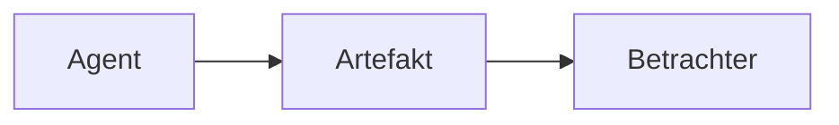

# Beispiel-Bericht

Ein Absatz mit **fett**, *kursiv*, `Code` und einem [Link nach außen](https://example.com).

## Tabelle

| Typ | Betrachter | Zeilen |
|---|---|---|
| Markdown | formatiert | nein |
| Log | Zeilen | ja |

## Code

```ts
// Gruß mit Typ
function greet(name: string): string {
  return `Hallo ${name}`;
}
```

## Diagramm



## Aufgaben

- [x] Betrachter gebaut
- [ ] Screenshots geprüft

<script>alert(1)</script>


> Zitat mit Wirkung.
